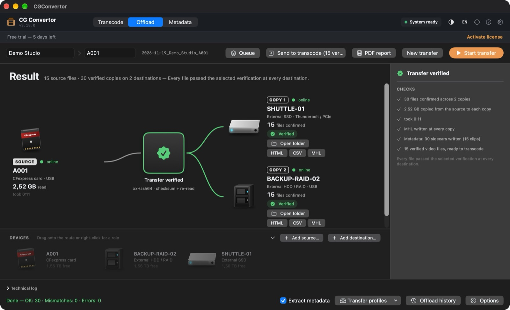
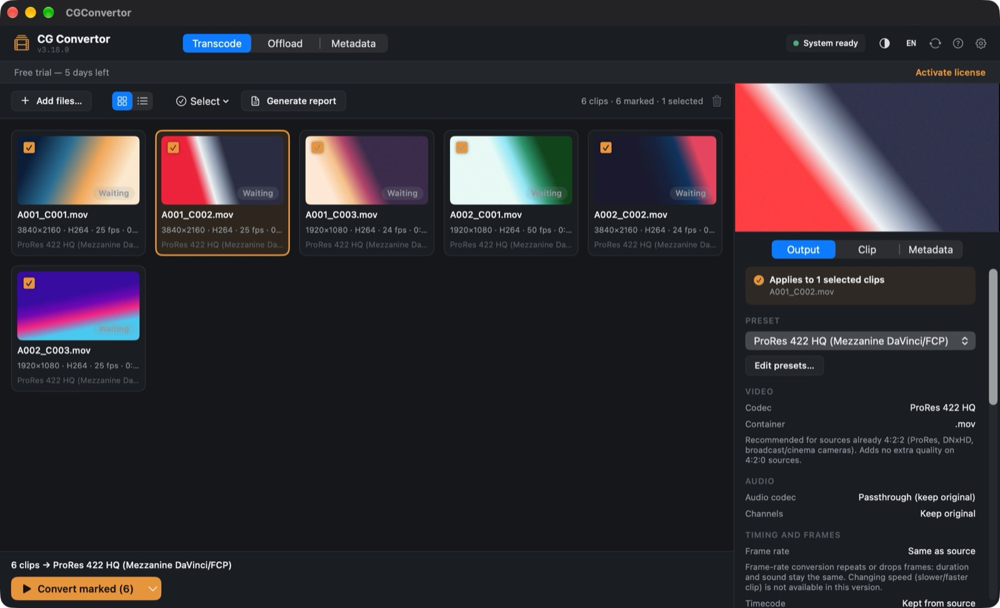
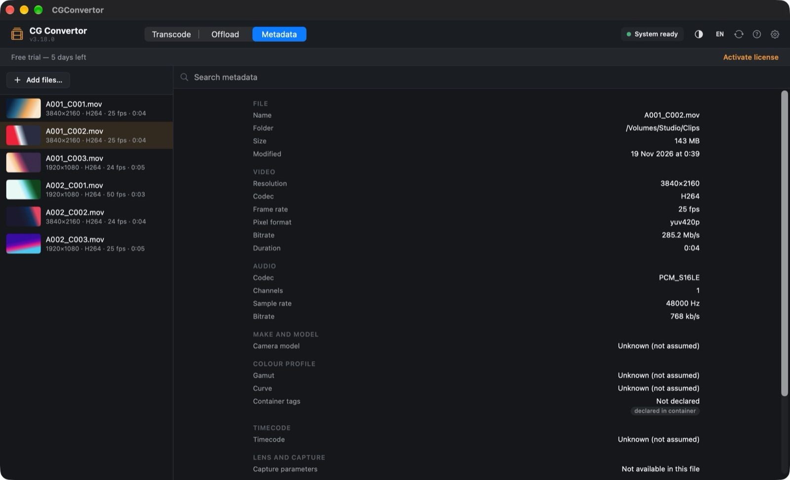

<div align="center">


# CG Convertor

**Transcode, verified copy and metadata for DaVinci Resolve, on Mac.**

[🇷🇴 Română](README.md) · [🇬🇧 English](README.en.md) · [🇪🇸 Español](README.es.md)

[**Product page**](https://gordas.dev/cgconvertor/) · [**Download (.dmg)**](https://github.com/gordasgdc/CGConvertor/releases/latest/download/CGConvertor.dmg) · [Releases](https://github.com/gordasgdc/CGConvertor/releases) · [Manual (PDF)](https://github.com/gordasgdc/CGConvertor/releases/latest/download/Instructiuni_Utilizare.pdf)

<br>



</div>

## What it does

Convert clips for DaVinci Resolve while timecode and the camera's native tracks stay in the file when the image stays Log. Every clip has a report: what was kept, what was not, and why.

| Transcode | Metadata |
|:--:|:--:|
|  |  |

- **Transcode** — drag clips into the window, mark what gets converted, choose the preset (ProRes, DNxHD/DNxHR) in the inspector. Summary and warnings before starting; existing results are never overwritten.
- **Offload** — copy to one or more destinations, verified by re-reading and checksum. “Copied” does not mean “verified”: each destination shows its own verdict. HTML, CSV, MHL and PDF reports; only verified files are sent to transcode.
- **Metadata** — gamut and curve separately, timecode with its type, make, model, lens. Every value shows where it comes from; unknown stays unknown, and the original is never modified.

## Requirements and installation

- macOS 14 or later, **Apple Silicon Mac** (no Intel version).
- The app is Developer ID signed and notarized.

1. Download [`CGConvertor.dmg`](https://github.com/gordasgdc/CGConvertor/releases/latest/download/CGConvertor.dmg) (or `CGConvertor.pkg`).
2. Open the package and follow the steps; the app lands in `Applications`.
3. The 5-day trial starts on first launch. Pick the language (RO / EN / ES) and theme (System / Light / Dark) in settings.
4. First run: in **Offload** choose the source and destinations, start the transfer, then use “Send to transcode”.

Windows: a separate version is available under [Releases](https://github.com/gordasgdc/CGConvertor/releases); it does not include the 3.18 improvements.

## Documentation

- [User manual (PDF)](https://github.com/gordasgdc/CGConvertor/releases/latest/download/Instructiuni_Utilizare.pdf) — RO / EN / ES
- [What's new in 3.18.0 (PDF)](https://github.com/gordasgdc/CGConvertor/releases/latest/download/CGConvertor-Imbunatatiri-3.18.0.pdf)
- [Version history](CHANGELOG.md) (Romanian)

## Licensing

5-day trial with full access, then a licence for 3, 6 or 12 months or perpetual, tied to your computer. The app does not use donations. Terms are given on the contact channel.

## Important limits

- Resolve assigns the Log profile automatically only on the cameras tested (verified: Canon C50). On Sony A7 IV and Panasonic DC-S1 it reads only the timecode; other brands were not tested.
- Native tracks are not kept when you choose a colour label, change the frame rate, or the container is not MOV.
- A valid file is not automatically complete: if writing the metadata fails, the clip shows a warning.
- Installation on a clean Mac and the live System theme were not verified separately.

Full list and explanations: [gordas.dev/cgconvertor](https://gordas.dev/cgconvertor/#limite).

## For developers

Xcode project (SwiftUI) at the repository root.

```bash
./build_app.sh        # build and install locally
./build_installer.sh  # signed and notarized .pkg (Developer ID certificates required)
```

The `ffmpeg`, `ffprobe` and `gdc-metadata-core` binaries are bundled with the app; their licences: [THIRD_PARTY_NOTICES.md](THIRD_PARTY_NOTICES.md). The legacy Python variant, used for Windows, lives in [`python/`](python/README.md). The code is public for reference; the repository does not declare a separate code licence.

---

Made by **Cristi Gordaș** (GDC) · [YouTube](https://youtube.com/@cristigordas) · [gordas.dev](https://gordas.dev/)
