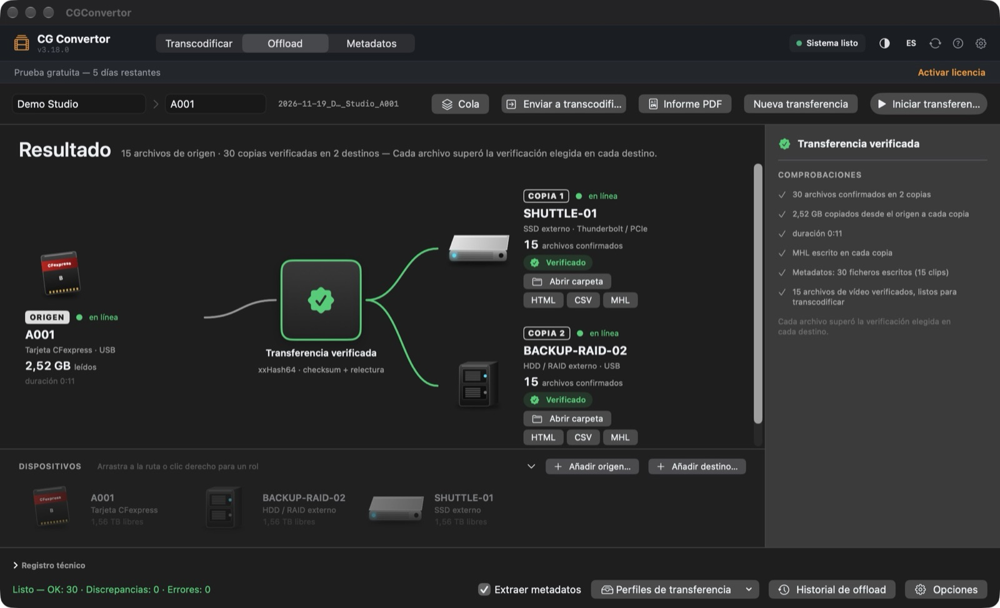
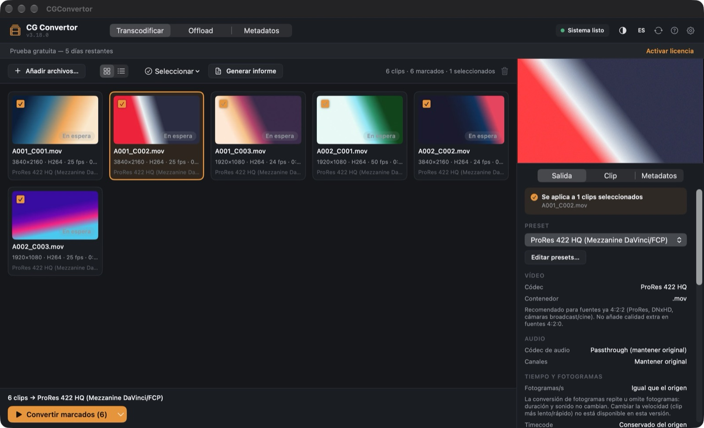
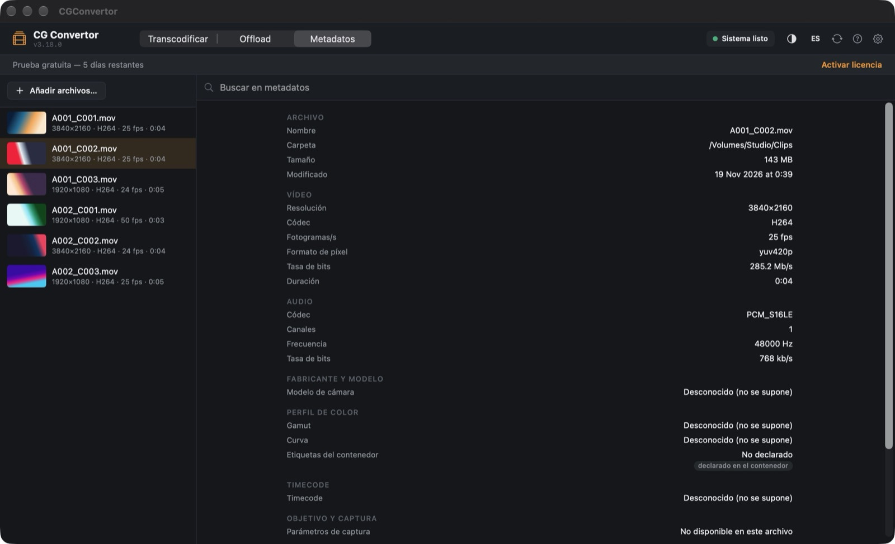
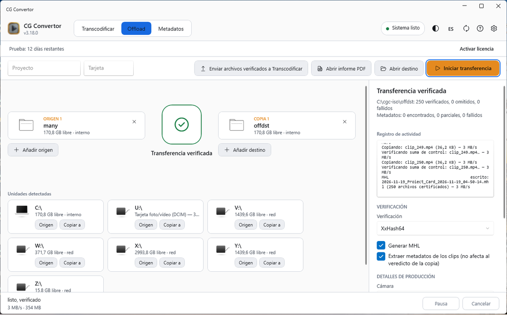

<div align="center">


# CG Convertor

**Transcodificación, copia verificada y metadatos para DaVinci Resolve, en Mac y Windows.**

[🇷🇴 Română](README.md) · [🇬🇧 English](README.en.md) · [🇪🇸 Español](README.es.md)

[**Página del producto**](https://gordas.dev/cgconvertor/) · [**Descargar (.dmg)**](https://github.com/gordasgdc/CGConvertor/releases/latest/download/CGConvertor.dmg) · [**Descargar para Windows (preliminar)**](https://github.com/gordasgdc/CGConvertor/releases/download/win-v3.18.0/CGConvertor-Windows-3.18.0.exe) · [Versiones](https://github.com/gordasgdc/CGConvertor/releases) · [Manual (PDF)](https://github.com/gordasgdc/CGConvertor/releases/latest/download/Instructiuni_Utilizare.pdf)

<br>



</div>

## Qué hace

Convierte clips para DaVinci Resolve mientras el timecode y las pistas nativas de la cámara se quedan en el archivo cuando la imagen sigue en Log. Cada clip tiene un informe: qué se conservó, qué no y por qué.

| Transcodificar | Metadatos |
|:--:|:--:|
|  |  |

- **Transcodificar** — arrastra clips a la ventana, marca lo que se convierte y elige el preset (ProRes, DNxHD/DNxHR) en el inspector. Resumen y avisos antes de empezar; los resultados existentes no se sobrescriben.
- **Offload** — copia a uno o más destinos, verificada por relectura y suma de control. «Copiado» no significa «verificado»: cada destino muestra su veredicto. Informes HTML, CSV, MHL y PDF; solo los archivos verificados pasan a transcodificar.
- **Metadatos** — gamut y curva por separado, timecode con su tipo, fabricante, modelo, objetivo. Cada valor muestra su procedencia; lo desconocido sigue desconocido y el original nunca se modifica.

## Requisitos e instalación

- macOS 14 o posterior, **Mac con Apple Silicon** (no hay versión para Intel).
- La app está firmada con Developer ID y notarizada.

1. Descarga [`CGConvertor.dmg`](https://github.com/gordasgdc/CGConvertor/releases/latest/download/CGConvertor.dmg) (o `CGConvertor.pkg`).
2. Abre el paquete y sigue los pasos; la app queda en `Applications`.
3. La prueba de 5 días empieza en el primer arranque. Elige idioma (RO / EN / ES) y tema (Sistema / Claro / Oscuro) en los ajustes.
4. Primera operación: en **Offload** elige origen y destinos, inicia la transferencia y usa «Enviar a transcodificar».

### Descarga por plataforma

| | macOS | Windows (versión preliminar) |
|:--|:--|:--|
| Descarga | [`CGConvertor.dmg`](https://github.com/gordasgdc/CGConvertor/releases/latest/download/CGConvertor.dmg) / [`.pkg`](https://github.com/gordasgdc/CGConvertor/releases/latest/download/CGConvertor.pkg) | [`CGConvertor-Windows-3.18.0.exe`](https://github.com/gordasgdc/CGConvertor/releases/download/win-v3.18.0/CGConvertor-Windows-3.18.0.exe) · [página de la versión](https://github.com/gordasgdc/CGConvertor/releases/tag/win-v3.18.0) |
| Versión | 3.18.0 | 3.18.0, marcada como «preliminar» |
| Requisitos | macOS 14+, Mac con Apple Silicon | Windows 10/11 de 64 bits (también funciona en Windows ARM mediante emulación x64) |
| Firma | Developer ID, notarizada por Apple | Firmado con un certificado propio, **sin confianza pública**: Windows puede mostrar el aviso de SmartScreen («Más información» → «Ejecutar de todas formas»). No equivale a un paquete notarizado por Apple. |
| Manual | [PDF RO / EN / ES](https://github.com/gordasgdc/CGConvertor/releases/latest/download/Instructiuni_Utilizare.pdf) | PDF de Windows: [RO](https://github.com/gordasgdc/CGConvertor/blob/main/windows/guides/Instructiuni_Utilizare_RO.pdf) · [EN](https://github.com/gordasgdc/CGConvertor/blob/main/windows/guides/Instructiuni_Utilizare_EN.pdf) · [ES](https://github.com/gordasgdc/CGConvertor/blob/main/windows/guides/Instructiuni_Utilizare_ES.pdf) |

Las capturas de arriba son de la versión de macOS. En Windows, los mismos tres espacios de trabajo (Transcodificar, Offload, Metadatos):



## Documentación

- [Manual de uso (PDF)](https://github.com/gordasgdc/CGConvertor/releases/latest/download/Instructiuni_Utilizare.pdf) — RO / EN / ES
- [Novedades de la 3.18.0 (PDF)](https://github.com/gordasgdc/CGConvertor/releases/latest/download/CGConvertor-Imbunatatiri-3.18.0.pdf)
- [Historial de versiones](CHANGELOG.md) (en rumano)

## Licencia

Prueba de 5 días con acceso completo, luego licencia de 3, 6 o 12 meses o perpetua, ligada a tu ordenador. La app no usa donaciones. Las condiciones se comunican por el canal de contacto.

## Límites importantes

- Resolve asigna el perfil Log automáticamente solo en las cámaras probadas (verificado: Canon C50). En Sony A7 IV y Panasonic DC-S1 solo lee el timecode; otras marcas no se probaron.
- Las pistas nativas no se conservan si eliges una etiqueta de color, cambias los fotogramas/s o el contenedor no es MOV.
- Un archivo válido no es automáticamente completo: si falla la escritura de metadatos, el clip muestra una advertencia.
- La instalación en un Mac limpio y el tema «Sistema» en ejecución no se verificaron por separado.

Lista completa y explicaciones: [gordas.dev/cgconvertor](https://gordas.dev/cgconvertor/#limite).

## Para desarrolladores

Proyecto Xcode (SwiftUI) en la raíz del repositorio.

```bash
./build_app.sh        # compila e instala en local
./build_installer.sh  # .pkg firmado y notarizado (requiere certificados Developer ID)
```

Los binarios `ffmpeg`, `ffprobe` y `gdc-metadata-core` se incluyen en la app; sus licencias: [THIRD_PARTY_NOTICES.md](THIRD_PARTY_NOTICES.md). La variante Python heredada (versiones antiguas de Windows, ya no distribuidas) está en [`python/`](python/README.md). El código es público para consulta; el repositorio no declara una licencia de código aparte. Las fuentes de la versión de Windows 3.18 están en [`windows/`](windows/).

---

Creado por **Cristi Gordaș** (GDC) · [YouTube](https://youtube.com/@cristigordas) · [gordas.dev](https://gordas.dev/)
