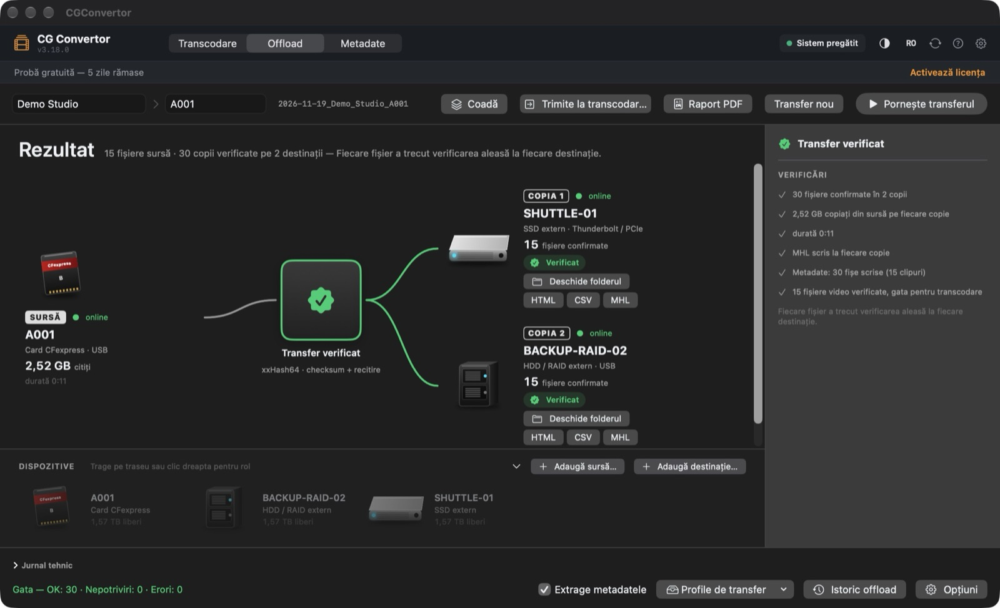
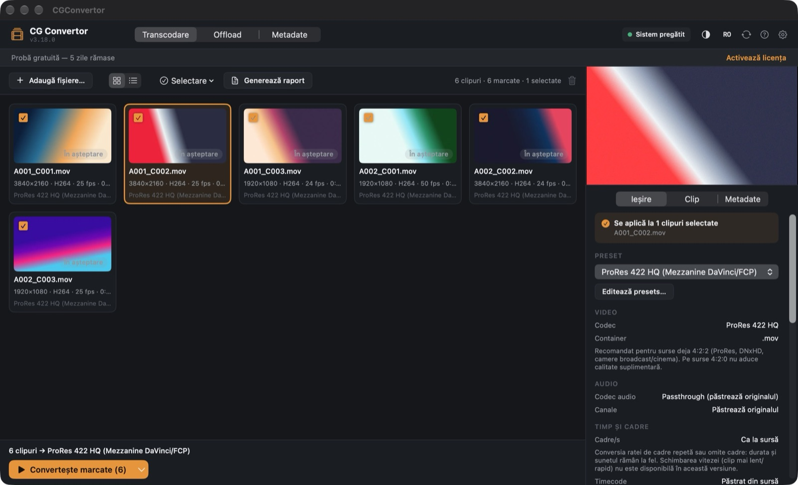
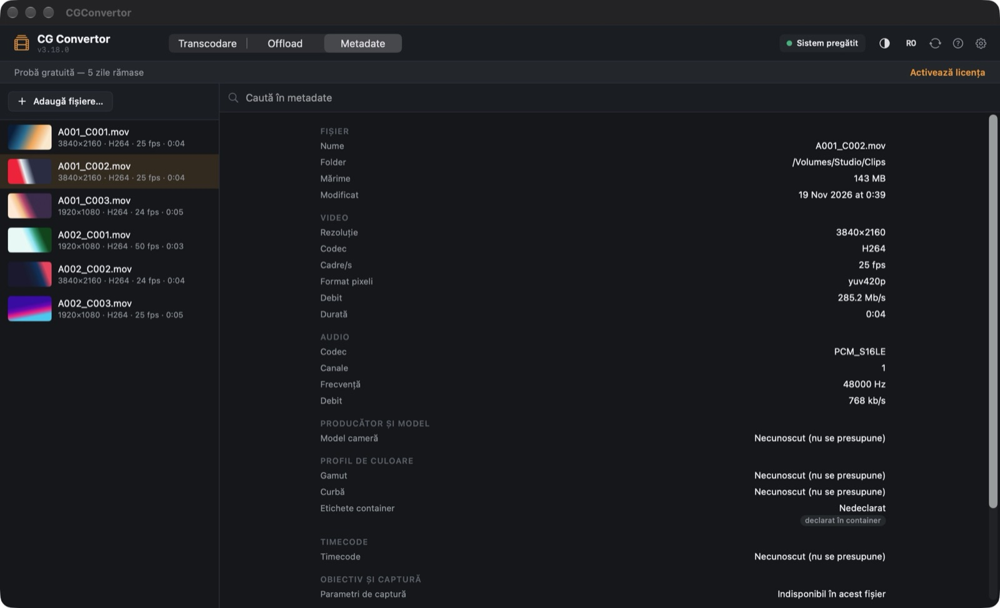

<div align="center">


# CG Convertor

**Transcodare, copiere verificată și metadate pentru DaVinci Resolve, pe Mac.**

[🇷🇴 Română](README.md) · [🇬🇧 English](README.en.md) · [🇪🇸 Español](README.es.md)

[**Pagina produsului**](https://gordas.dev/cgconvertor/) · [**Descarcă (.dmg)**](https://github.com/gordasgdc/CGConvertor/releases/latest/download/CGConvertor.dmg) · [Versiuni](https://github.com/gordasgdc/CGConvertor/releases) · [Manual (PDF)](https://github.com/gordasgdc/CGConvertor/releases/latest/download/Instructiuni_Utilizare.pdf)

<br>



</div>

## Ce face

Convertești clipurile pentru DaVinci Resolve, iar timecode-ul și pistele native ale camerei rămân în fișier când imaginea rămâne Log. Fiecare clip are un raport: ce s-a păstrat, ce nu și de ce.

| Transcodare | Metadate |
|:--:|:--:|
|  |  |

- **Transcodare** — tragi clipurile în fereastră, marchezi ce se convertește, alegi presetarea (ProRes, DNxHD/DNxHR) în inspector. Rezumat și avertismente înainte de pornire; rezultatele existente nu se suprascriu.
- **Offload** — copiere pe una sau mai multe destinații, cu verificare prin recitire și sumă de control. „Copiat” nu înseamnă „verificat”: fiecare destinație își arată verdictul. Raport HTML, CSV, MHL și PDF; către transcodare merg doar fișierele verificate.
- **Metadate** — gamut și curbă separate, timecode cu tipul lui, producător, model, obiectiv. Fiecare valoare își arată proveniența; necunoscutul rămâne necunoscut, iar originalul nu se modifică.

## Cerințe și instalare

- macOS 14 sau mai nou, **Mac cu Apple Silicon** (nu există versiune pentru Intel).
- Aplicația este semnată Developer ID și notarizată.

1. Descarcă [`CGConvertor.dmg`](https://github.com/gordasgdc/CGConvertor/releases/latest/download/CGConvertor.dmg) (sau `CGConvertor.pkg`).
2. Deschide pachetul și urmează pașii; aplicația ajunge în `Applications`.
3. La prima pornire începe proba de 5 zile. Alege limba (RO / EN / ES) și tema (Sistem / Deschisă / Închisă) din setări.
4. Prima operație: în **Offload** alege sursa și destinațiile, apoi pornește transferul; la final folosește „Trimite la transcodare”.

Windows: există o versiune separată în [Versiuni](https://github.com/gordasgdc/CGConvertor/releases); nu are îmbunătățirile din 3.18.

## Documentație

- [Manual de utilizare (PDF)](https://github.com/gordasgdc/CGConvertor/releases/latest/download/Instructiuni_Utilizare.pdf) — RO / EN / ES
- [Îmbunătățiri în 3.18.0 (PDF)](https://github.com/gordasgdc/CGConvertor/releases/latest/download/CGConvertor-Imbunatatiri-3.18.0.pdf)
- [Istoricul versiunilor](CHANGELOG.md)

## Licențiere

Probă de 5 zile cu acces complet, apoi licență pe 3, 6 sau 12 luni ori perpetuă, legată de calculator. Aplicația nu folosește donații. Condițiile se comunică pe canalul de contact.

## Limite importante

- Resolve atribuie automat profilul Log doar la camerele testate (verificat: Canon C50). La Sony A7 IV și Panasonic DC-S1 citește doar timecode-ul; celelalte mărci nu au fost testate.
- Pistele native nu se păstrează când alegi o etichetă de culoare, schimbi cadrele/s sau containerul nu e MOV.
- Un fișier valid nu e automat complet: dacă scrierea metadatelor eșuează, clipul apare cu avertisment.
- Instalarea pe un Mac curat și tema „Sistem” în timpul rulării nu au fost verificate separat.

Lista completă și explicațiile: [gordas.dev/cgconvertor](https://gordas.dev/cgconvertor/#limite).

## Pentru dezvoltatori

Proiect Xcode (SwiftUI), în rădăcina depozitului.

```bash
./build_app.sh        # construiește și instalează local
./build_installer.sh  # pachet .pkg semnat și notarizat (certificate Developer ID necesare)
```

Binarele `ffmpeg`, `ffprobe` și `gdc-metadata-core` sunt incluse în aplicație; licențele lor: [THIRD_PARTY_NOTICES.md](THIRD_PARTY_NOTICES.md). Varianta Python moștenită, folosită pentru Windows, e în [`python/`](python/README.md). Codul este public pentru consultare; depozitul nu declară o licență de cod separată.

---

Creat de **Cristi Gordaș** (GDC) · [YouTube](https://youtube.com/@cristigordas) · [gordas.dev](https://gordas.dev/)
